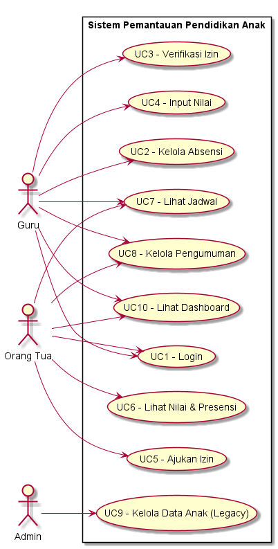
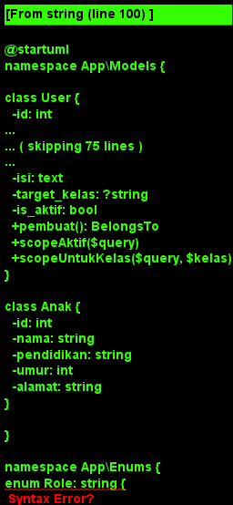
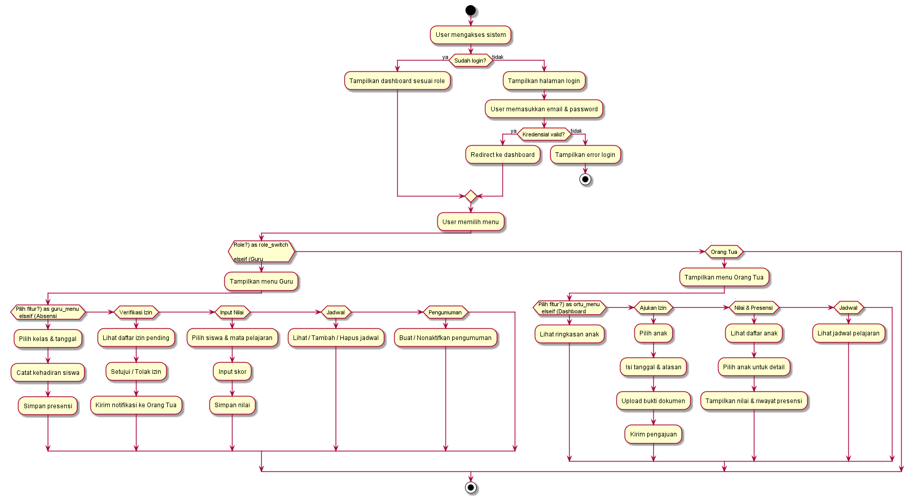
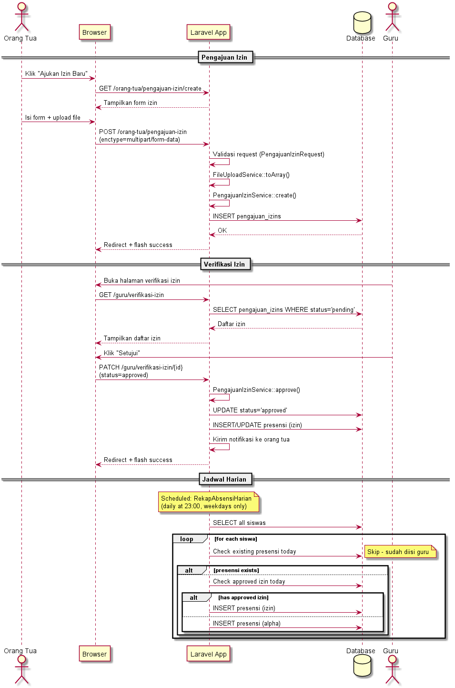
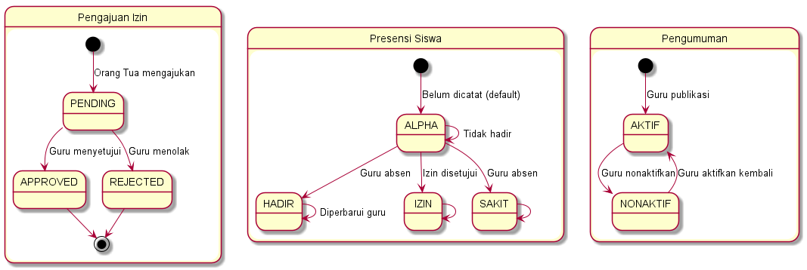
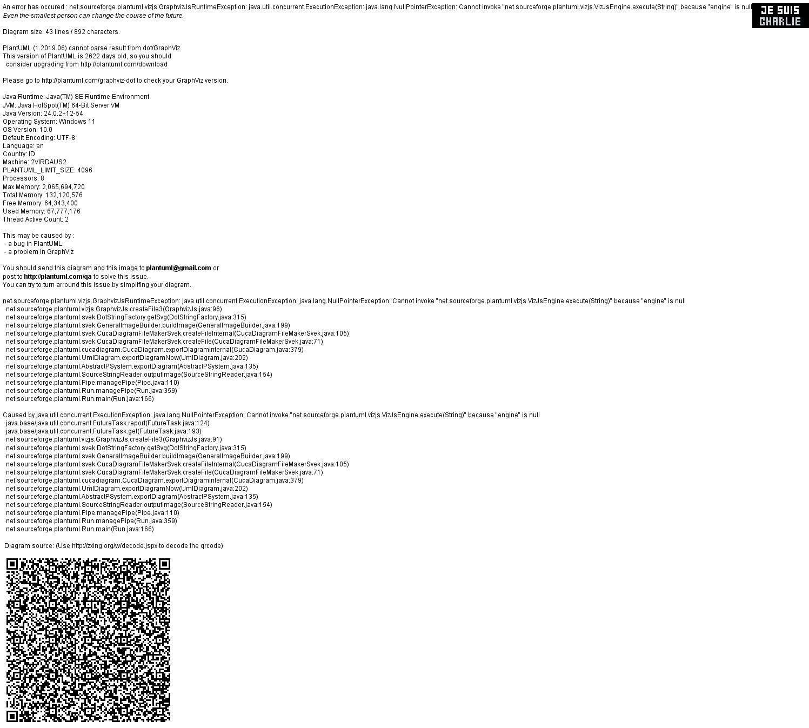
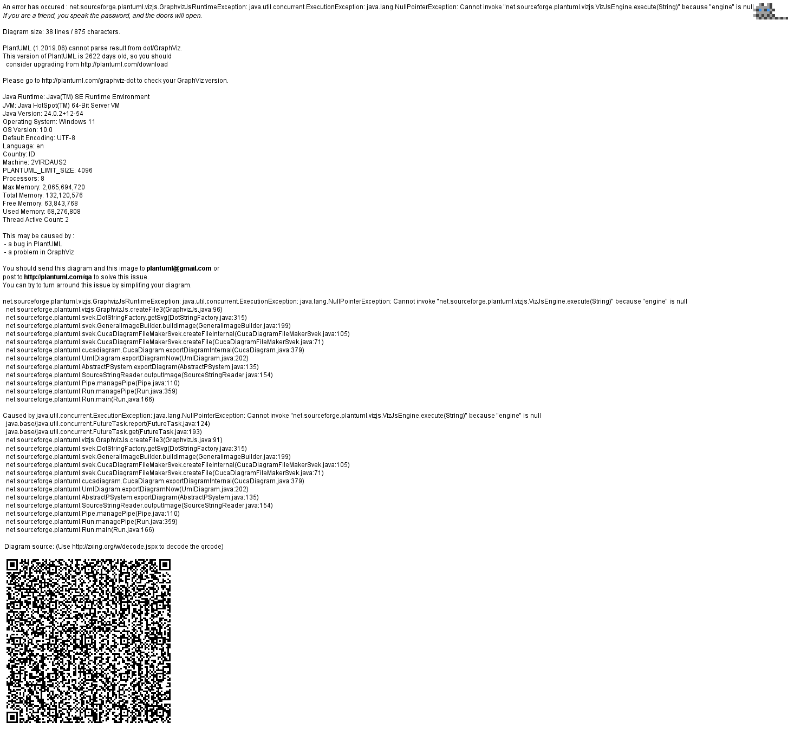

# Pemantauan Pendidikan Anak

Sistem monitoring siswa SD dengan pengajuan izin daring, absensi harian, nilai, jadwal pelajaran, dan notifikasi otomatis. Dibangun dengan **Laravel** dan **Tailwind CSS**.

## Fitur

| Fitur | Guru | Orang Tua |
|-------|------|-----------|
| Dashboard ringkasan | ✅ | ✅ |
| Absensi siswa per kelas | ✅ | — |
| Verifikasi izin | ✅ | — |
| Input & kelola nilai | ✅ | — |
| Lihat jadwal pelajaran | ✅ | ✅ |
| Kelola pengumuman | ✅ | ✅ |
| Pengajuan izin daring | — | ✅ |
| Lihat nilai & presensi anak | — | ✅ |
| Status kehadiran real-time | — | ✅ |

## Teknologi

- **Backend**: Laravel 13, PHP 8.3
- **Database**: MySQL (`db_anak`)
- **Frontend**: Tailwind CSS (CDN), Google Fonts (Inter)
- **Auth**: Session-based + database session driver
- **Notifikasi**: Mail + Database
- **File Storage**: MySQL base64 (file bukti izin)

## Struktur Arsitektur

```
app/
├── Enums/           → Role, StatusPengajuan
├── Models/          → User, Siswa, Presensi, Nilai, PengajuanIzin, JadwalPelajaran, Pengumuman
├── Services/        → Logika bisnis (DashboardService, PresensiService, NilaiService, PengajuanIzinService, JadwalService, PengumumanService, FileUploadService)
├── Http/
│   ├── Controllers/ → Auth, Guru/* (Dashboard, Nilai, Presensi, VerifikasiIzin), OrangTua/* (Dashboard, Nilai, PengajuanIzin), JadwalController, PengumumanController
│   ├── Requests/    → PengajuanIzinRequest, VerifikasiIzinRequest, StoreNilaiRequest
│   └── Middleware/   → RoleMiddleware
├── Notifications/   → PengajuanIzinStatusChanged
└── Jobs/            → RekapAbsensiHarian
```

## Role & Akun Demo

Setelah `db:seed`, tersedia 4 akun:

| Role | Email | Password |
|------|-------|----------|
| Guru | guru@example.com | password |
| Guru | guru2@example.com | password |
| Orang Tua | ortu@example.com | password |
| Orang Tua | ortu2@example.com | password |

## Instalasi

```bash
# 1. Clone repositori
git clone https://github.com/2VIRDAUS2/pemantauan-pendidikan-anak.git
cd pemantauan-pendidikan-anak

# 2. Install dependency PHP
composer install

# 3. Copy & sesuaikan konfigurasi database
cp .env.example .env
# edit .env: atur DB_DATABASE, DB_USERNAME, DB_PASSWORD sesuai MySQL Anda

# 4. Generate app key
php artisan key:generate

# 5. Buat database MySQL (sesuai nama di .env)
mysql -u root -p -e "CREATE DATABASE IF NOT EXISTS db_anak CHARACTER SET utf8mb4 COLLATE utf8mb4_unicode_ci;"

# 6. Jalankan migrasi & seeder
php artisan migrate --seed

# 7. Optimasi
php artisan optimize:clear

# 8. Jalankan dev server
php artisan serve
```

## Menjalankan Queue Notifikasi

Notifikasi email & database berjalan via queue. Jalankan di terminal terpisah:

```bash
php artisan queue:work
```

## Menjalankan Scheduled Task

Rekap absensi harian berjalan otomatis via Laravel Scheduler. Di Windows/Laragon:

```bash
# Jalankan scheduler secara manual setiap menit
php artisan schedule:run
```

Di production (Linux), tambahkan cron:

```bash
* * * * * cd /path-to-project && php artisan schedule:run >> /dev/null 2>&1
```

## Testing

```bash
php artisan test
```

Atau spesifik:

```bash
php artisan test --filter=PengajuanIzinTest
```

## UML

### 1. Use Case Diagram



### 2. Class Diagram



### 3. Activity Diagram



### 4. Sequence Diagram



### 5. State Diagram



### 6. Component Diagram



### 7. Deployment Diagram




## Lisensi

MIT
